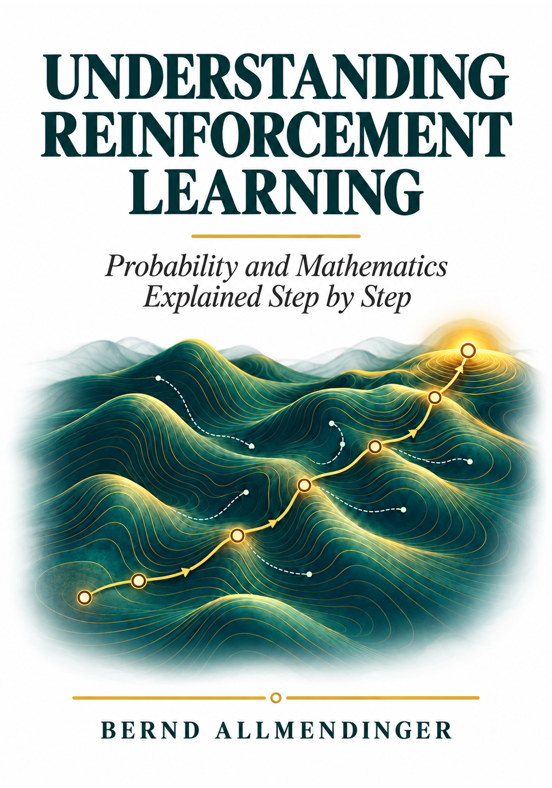

# Understanding Reinforcement Learning — Companion Code



Executable, step-by-step tutorials for **Understanding Reinforcement Learning: Probability and Mathematics Explained Step by Step** by **Bernd Allmendinger**.

See a learning rule change a table, inspect what each entry means, and play against the trained agent. The two notebooks follow the book's mathematical approach: conditional expectations, observed rewards, computed targets and learned parameters are kept distinct. Every main method includes its formula and an explanation of the corresponding code.

## Start in Google Colab

| Example | Notebook | Run in your browser |
|---|---|---|
| One-pile Nim-style game: taking the last match loses | [Nim notebook](notebooks/01_nim.ipynb) | [](https://colab.research.google.com/github/berndAllmendinger/understanding-reinforcement-learning/blob/main/notebooks/01_nim.ipynb) |
| Tic-Tac-Toe: learner X against a fixed O opponent | [Tic-Tac-Toe notebook](notebooks/02_tic_tac_toe.ipynb) | [](https://colab.research.google.com/github/berndAllmendinger/understanding-reinforcement-learning/blob/main/notebooks/02_tic_tac_toe.ipynb) |

**Before publication:** the badges are prepared for `berndAllmendinger/understanding-reinforcement-learning`, branch `main`. They become usable when these files are uploaded there. You can already upload either `.ipynb` directly into [Google Colab](https://colab.research.google.com/) using **File → Upload notebook**. No other repository file is needed to run it.

Run cells from top to bottom, or choose **Runtime → Run all**. Use a normal Python CPU runtime; no GPU, API key, external training dataset or simulation model is required. The last interactive cell has `PLAY = False` so a complete run does not wait for input. Change it to `True` and run that cell to play.

## Learning path

| Step | What is learned? | What can the reader inspect? |
|---|---|---|
| Environment and records | Nothing yet: rules and rewards are supplied | Legal actions, complete state encodings, observed transitions |
| Monte Carlo control | A table of averaged sampled returns | Final rewards versus earlier returns; the full Nim table |
| SARSA | Action values under exploratory continuation | The target using the actual next selected action |
| Q-learning | Action values aimed at optimal continuation in the fixed training environment | One numerical update; marked cell; tables before, during and after training |
| REINFORCE | Legal action probabilities via adjustable scores | The direct policy-gradient bridge to PPO |
| Tabular PPO-Clip | Policy scores and a separate state-value critic | Old probabilities, advantages, clipping and repeated batch updates |
| Evaluation and play | No further learning | Fresh test games, an exact adversarial check, complete playthroughs, human play |

Nim uses piles of 1–9 matches and the book's take-two opponent by default. The random-opponent alternative is explicit. Tic-Tac-Toe uses ordinary rules and a uniformly random O opponent. X always starts; the human plays O. A learning transition includes the learner's move and the opponent's reply, so successive recorded states belong to the same learner. This avoids hidden changes of player perspective.

Nim's complete small tables fit on screen. For Tic-Tac-Toe, selected full board rows are shown and a slice selector lets you inspect other stored rows. Illegal actions are labelled and excluded everywhere. Unvisited entries start at zero; zero is an initial guess, not evidence of a draw.

## Why plain Python instead of a framework?

The notebooks use NumPy, pandas and Matplotlib. Each environment and each update is visible in the notebook; there is no custom package to install or hidden training engine. PPO uses a **tabular softmax policy**, not a neural network. This preserves its clipped objective while keeping the learned parameters inspectable. It is a teaching implementation, without GAE, entropy bonuses, automatic differentiation or production-scale tuning.

[Gymnasium](https://gymnasium.farama.org/) is a useful next step when a standard environment interface or a larger RL library is needed. It does not itself perform the learning. For these two examples, the extra wrapper would add code without explaining the underlying update more clearly. The book's neural-network and industrial examples remain separate.

## Installation

Colab: open a notebook and run it. Both notebooks are self-contained and use packages normally included in Colab.

For a local installation with Python 3.9 or newer, open a terminal in this repository:

```text
python -m venv .venv
```

Activate it on Windows with `.venv\Scripts\activate`, or on macOS/Linux with `source .venv/bin/activate`, then run:

```text
python -m pip install -r requirements.txt
jupyter lab
```

Open either file in `notebooks`. The committed outputs let you read the worked results without training first. To reproduce those results, run from a fresh kernel with the printed settings. For the exact versions used in local validation, see [reproducibility](docs/REPRODUCIBILITY.md).

## Data licensing and provenance

All training and evaluation records are generated by the visible game rules and seeded random draws. There are no customer files, proprietary simulation models, personal data or third-party gameplay datasets. Constructed hand calculations are labelled separately from fitted runs. The notebooks make no network requests while training or playing.

The cover is the author's approved white/petrol front cover, copied unchanged from the 300 dpi book export. The cover and book manuscript are **not** covered by the code licence. See [asset rights](ASSET_RIGHTS.md) and [provenance](docs/PROVENANCE.md).

## Reproducibility principles

- Fix and print the game rules, player perspective, training opponent and starting-state distribution.
- Set seeds before fitting; keep test randomness separate and freeze parameters during evaluation.
- Distinguish observed immediate reward, complete return, estimated target, value and action probability.
- Apply the legal-action mask in exploration, greedy selection, policy normalisation and next-state targets.
- Compare a finite training run with an exact reference only **after** fitting; never train on the reference answers.
- Distinguish fixed-opponent performance from worst-case game strength, and deterministic policy deployment from sampling.
- Keep weak results visible. A method name or a good win rate is not a convergence or perfect-play certificate.
- Preserve executed outputs and package versions. A single seeded example is not a statistical benchmark.

See [reproducibility and checks](docs/REPRODUCIBILITY.md) for the settings and limitations. These new teaching runs share the book's conventions but do not reproduce the exact numerical experiment in manuscript v21: the code intentionally uses simpler settings.

## Licence and book reference

The original companion code and its teaching explanations are provided under the [MIT License](LICENSE). The cover and book manuscript are excluded; see [ASSET_RIGHTS.md](ASSET_RIGHTS.md). This follows the code-versus-book distinction in the author's [Quantitative Sports Betting companion repository](https://github.com/berndAllmendinger/quantitative-sports-betting).

**Book:** Bernd Allmendinger, *Understanding Reinforcement Learning: Probability and Mathematics Explained Step by Step*. ISBN and purchase link will be added when available.

**Background references:** Sutton and Barto, *Reinforcement Learning: An Introduction*, second edition (2018), Chapters 5, 6 and 13; Schulman et al., [*Proximal Policy Optimization Algorithms*](https://arxiv.org/abs/1707.06347) (2017). No figures or prose from these works are redistributed here.
